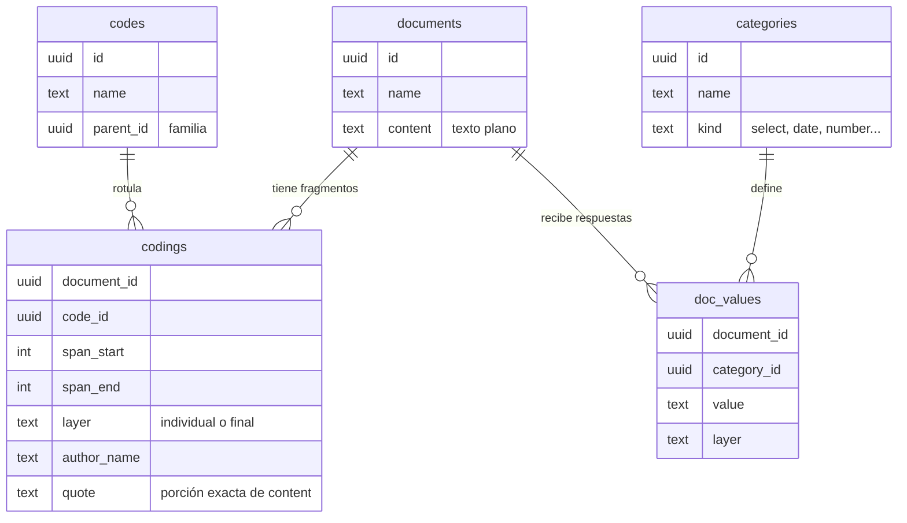

<p align="center">
  <a href="https://luizpf42.github.io/QualiLab"></a>
</p>

<p align="center"><a href="README.md">Português</a> · <a href="README.en.md">English</a> · <b>Español</b></p>

<h1 align="center">QualiLab</h1>

<p align="center">
  <b>tu propio laboratorio de investigación cualitativa</b><br>
  <sub>o seu laboratório de pesquisa qualitativa</sub>
</p>

<p align="center">
  <a href="https://doi.org/10.5281/zenodo.21935682">
    
  </a>
</p>

QualiLab es una herramienta **gratuita y de código abierto** para el análisis cualitativo de datos. Funciona entera en un único archivo `index.html`: sin instalación, sin servidor propio, sin suscripción.

**▶ [Abrir QualiLab en el navegador](https://luizpf42.github.io/QualiLab)** — es una URL, no hay nada que instalar.

**⬇ [Instalar como aplicación](docs/MANUAL.es.md#instalar-como-aplicación-y-abrir-sin-internet)** — abre sin internet, tiene ventana e ícono propios, y el doble clic en un `.qualilab` pasa a abrirlo en QualiLab. **En Windows, instálalo con Edge.**

**📖 [Manual de uso](https://luizpf42.github.io/QualiLab/manual.html?lang=es)** — guía completa, paso a paso, de todas las pantallas. Lo que cambió en cada versión está en el [`CHANGELOG.md`](CHANGELOG.md) *(en portugués)*.

> Inspirado en **[Taguette](https://www.taguette.org/about.html)**, **[Magnolia](https://www.caledavis.eu/magnolia.html)**, **[QualCoder](https://github.com/ccbogel/qualcoder)** y **[OpenQDA](https://openqda.org/)** — proyectos que merecen tu apoyo; los créditos están [al final](#créditos-referencia-y-licencia).

<details>
<summary>🌐 <b>Una nota sobre el idioma</b> — la interfaz está en español; algunas cosas quedan en portugués a propósito</summary>

Desde la v1.4.70 la **interfaz de la aplicación existe en español**, y sigue a tu navegador: un navegador en español abre QualiLab en español, uno en portugués lo abre en portugués, y cualquier otro idioma lo abre en inglés; el selector en **Mi cuenta → Idioma** tiene prioridad sobre eso. Lo que queda en portugués es deliberado: las solicitudes que QualiLab envía a la IA (traducirlas cambia el comportamiento del modelo, y eso hay que medirlo antes) y el marcador de fragmento censurado dentro de los archivos exportados (para que el mismo archivo no cambie de contenido según quién lo exportó). Las **capturas de pantalla del manual siguen mostrando la interfaz en portugués**. El [`CHANGELOG.md`](CHANGELOG.md) sigue en portugués, igual que la guía para colaboradores, que vive en el repositorio de desarrollo.

</details>

> **Antes de usarlo con datos reales.** QualiLab es un proyecto personal, en desarrollo activo, distribuido bajo licencia MIT, sin garantía de ningún tipo, y todavía no ha pasado por una auditoría de seguridad independiente. Tampoco **anonimiza** tu material: la censura enmascara solo lo que marcaste a mano, y solo en algunas salidas. Adónde lleva tus datos cada modo de uso está en [Dónde quedan tus datos](#dónde-quedan-tus-datos); lo que la herramienta no hace por ti está en [Límites y responsabilidad](#límites-y-responsabilidad).
>
> **Exención.** QualiLab es un proyecto personal de [Luiz Pimenta Filho](https://orcid.org/0000-0002-5165-6232), en el ámbito del [LabDados / FGV Direito SP](https://direitosp.fgv.br/nucleos-de-pesquisa/laboratorio-dados-pesquisa-empirica-direito-labdados). No representa la posición ni implica la responsabilidad de ninguna institución (incluida la FGV). El autor no se responsabiliza por pérdida de datos, filtraciones, uso indebido ni otras consecuencias del uso del software; corresponde a quien lo usa adoptar las precauciones éticas y legales que su investigación exige.

<sub>La **versión en uso** aparece en la barra de estado, en el pie de la propia aplicación y en la pantalla de entrada. Cita ese número al reportar un problema: sin él no hay forma de saber qué versión cargó tu navegador.</sub>

---

## Por qué existe

Un relevamiento sistemático de 28 herramientas de análisis cualitativo, publicado en 2025 por Jan Küster y Karsten D. Wolf (Universidad de Bremen), concluye que **"el estado actual del CAQDAS es insuficiente para sostener plenamente prácticas de investigación cualitativa de ciencia abierta"**. Entre los hallazgos: el campo está dominado por software propietario (13 de las 28 herramientas examinadas), con licencias de **€95 a €430 por usuario/año**; la colaboración en tiempo real existe en **5** de las 28; el registro de auditoría del proceso de análisis, en **7**; una política de seguridad pública, en **2**; y, de las 9 herramientas con IA integrada, **ninguna revela al usuario el *system prompt*** que precede a las llamadas, mientras que solo **2** permiten usar un modelo local o propio. Los autores registran además que las herramientas veteranas "evolucionaron hacia aplicaciones grandes, complejas y pesadas, con interfaces a veces confusas".

A esos hallazgos QualiLab suma una queja de la práctica que el relevamiento no mide: el soporte para **categorías cerradas** (atributos estructurados por documento) es pobre en las herramientas grandes, lo que obliga al investigador a mantener hojas de cálculo paralelas para lo que debería estar integrado al análisis.

QualiLab busca ser lo más intuitivo posible: cargas un documento, seleccionas un fragmento y ya codificas, sin configuración previa. Al mismo tiempo, ofrece un esquema de categorías nativo (texto cerrado, texto abierto, número, fecha, sí/no, opción múltiple, casilla de verificación) que convive con la codificación de fragmentos de forma integrada, en el mismo entorno. Quien necesita conciliar análisis temático con recolección estructurada de atributos ya no tiene que alternar entre herramientas.

Las herramientas disponibles, pagas o gratuitas, tampoco tienen la colaboración y la investigación colectiva como objetivos principales. QualiLab busca un buen punto medio, desarrollado para necesidades individuales y colectivas: capas de codificación por investigador, reconciliación, roles de administrador, miembro y solo lectura, todo nativo, sin necesidad de hojas de cálculo paralelas ni de herramientas de terceros para coordinar al equipo.

> Küster, J.; Wolf, K. D. **The Current State of CAQDAS is Insufficient for Open Science Qualitative Research.** *Electronic Communications of the EASST*, v. 85 (deRSE25), 2025. DOI [10.14279/eceasst.v85.2709](https://doi.org/10.14279/eceasst.v85.2709), licencia CC-BY 4.0. Los autores desarrollan [OpenQDA](https://openqda.org/), que forma parte de la muestra examinada. Los números de arriba describen las 28 herramientas que **ellos** examinaron (QualiLab no estaba entre ellas) y valen para el relevamiento de 2025.

### Dónde está QualiLab en esa escala

Comparación directa con los hallazgos de Küster & Wolf (2025) sobre 28 herramientas de análisis cualitativo. El número del medio es cuántas de las 28 cumplen el criterio, según su relevamiento.

| Criterio | Relevamiento (n=28) | QualiLab |
|---|---|---|
| Licencia libre | 12 libres, 13 propietarias, 3 sin licencia | ✅ MIT |
| Costo por usuario/año | €95 a €430 en las propietarias | ✅ €0 |
| Funciona sin competencia técnica para instalar | señalado como **el** cuello de botella del software abierto del campo | ✅ es una URL, sin instalación y sin compilación |
| Windows · macOS · Linux · Web | 13 · 12 · 7 · 18 | ✅ los cuatro |
| Interoperabilidad REFI-QDA completa | 9 (7 de ellas propietarias) | ✅ QDPX + QDC, validados contra el `Project.xsd` oficial |
| Colaboración en tiempo real | 5 | ✅ |
| Sin servidor obligatorio | 20 ofrecen alguna forma de *on-premise* | ✅ el modo Archivo no tiene servidor alguno; la nube puede ser la tuya |
| Exportación sin pérdida para revisión | "la pérdida de datos en la exportación imposibilita la reproducción" | ✅ el `.qualilab` es *round-trip* completo |
| **`system prompt` de la IA visible al usuario** | **0** | ✅ el prompt entero se muestra antes de enviar |
| **`system prompt` editable** | 0 | ✅ postura, instrucciones y memos inyectados |
| Modelo de IA local o propio | 2 | ✅ Ollama local, endpoint propio, Azure |
| Análisis con IA sin pasar por un servidor del proveedor de la herramienta | 0 entre las propietarias | ✅ BYOK, el navegador llama directo al proveedor |
| Codificar texto · PDF | 26 · 6 | ✅ los dos (en el PDF, texto **y** región) |
| Codificar audio · video · imagen · hoja de cálculo | 11 · 12 · 11 · 2 | ❌ fuera de alcance (abajo) |
| **Registro de auditoría del proceso** | 7 | ✅ desde la 1.4.51: el historial de operaciones del proyecto (Memos ▸ Historial del proyecto), de solo agregado en la nube, exportable en CSV, con resumen en el Informe |
| Metadato de cita (`CITATION.cff`) | 3 | ✅ |
| Política de seguridad pública | 2 | ✅ [`SECURITY.md`](SECURITY.md) |
| Archivado con DOI (Zenodo) | 4 | ✅ [`10.5281/zenodo.21935682`](https://doi.org/10.5281/zenodo.21935682) |
| Arquitectura de plugins · scripts | 1 · 3 | ❌ por decisión (abajo) |

**Lo que queda fuera por alcance, y no por descuido.** QualiLab es una herramienta de **texto y PDF**. Audio, video e imagen exigen anotar sobre una línea de tiempo o sobre píxeles, que es otro producto y no una funcionalidad más. Para eso, mira [ELAN](https://archive.mpi.nl/tla/elan/), [Transana](https://www.transana.com/), [dicto](https://dictoapp.github.io/dicto/) o [QualCoder](https://github.com/ccbogel/qualcoder).

**Extensibilidad por datos, no por plugins.** QualiLab no tiene arquitectura de plugins, y no pretende tenerla: choca de frente con el diseño de archivo único que hace que la aplicación funcione sin instalación y sin compilación. Lo que ofrece en su lugar son tres superficies abiertas: el formato **`.qualilab`** (sin pérdida, documentado), la exportación en **REFI-QDA** y **W3C Web Annotation**, y un **servidor MCP de lectura** que permite a cualquier asistente leer el corpus con la censura ya aplicada.

---

## Qué hace

Una línea por recurso: esto es el inventario. El **paso a paso** de cada uno está en el [manual de uso](docs/MANUAL.es.md).

### Material

| Recurso | Qué es |
|---|---|
| **Formatos de entrada** | `.txt`, `.md`, `.docx`, `.pdf` y pegar texto. Hoja de cálculo (`.csv`/`.xlsx`): cada fila se convierte en un documento. Carpeta de **Zotero** (RDF): cada referencia con PDF se convierte en un documento, los metadatos en categorías y la referencia en memo |
| **Reflujo de PDF** | detecta **columnas** (un artículo a dos columnas deja de salir mezclado), quita encabezados, pies y números de página repetidos, rearma los párrafos sin depender del interlineado, corrige la división de palabras a fin de línea y elimina la sobreimpresión duplicada |
| **`.docx` sin basura** | títulos, listas y tablas se vuelven texto limpio mediante saltos de línea y sangría, **sin marcadores inyectados** (que se volverían contenido codificable) |
| **PDF original** | la página real, con tus resaltados dibujados encima; se puede seleccionar y codificar ahí mismo |
| **OCR en el navegador** | la página entera o **por área** (arrastra un rectángulo, revisa el texto leído, codifica). Sin conexión, sin servidor |
| **Página del fragmento** | la correspondencia fragmento ↔ página sobrevive a la ida y vuelta y aparece en la Lectura, en el Informe y en las exportaciones (CSV/JSON/W3C) |
| **Editar el texto extraído** | corrige la extracción y **reancla automáticamente los resaltados** ya hechos |
| **Señal de calidad** | avisa cuando un documento probablemente se extrajo mal (vacío, sin espacios entre palabras, glifos rotos, OCR de baja confianza) |

### Codificación y esquema

| Recurso | Qué es |
|---|---|
| **Codificar fragmentos** | selecciona y aplica con el botón derecho; **Ctrl+Z** deshace la última |
| **Códigos jerárquicos** | color por familia y tono por profundidad; matiz y saturación personalizables, propagados al subárbol |
| **Familia × código** | una sola regla: quien tiene subcódigos **agrupa** y no recibe fragmentos; el conteo de la familia suma los de sus hijos |
| **Categorías del documento** | siete tipos (texto cerrado, texto abierto, número, fecha, sí/no, opción múltiple, casilla de verificación). La descripción de cada una es la **instrucción de codificación** — el mismo texto que lee la persona y que entra en el prompt de la IA |
| **Esquema en lote** | agrupar, fusionar, promover a Jerarquía 0, **dividir** un código en subcódigos, y un **mapa espacial** de los códigos |
| **Conexiones** | relación con nombre entre dos códigos, dos categorías o uno de cada (*contradice*, *es parte de*, *es causa de*), con dirección, comentario y, opcionalmente, un fragmento como evidencia |
| **Búsqueda** | literal (expresión regular, mayúsculas, palabra completa) y global en todo el corpus |
| **Censura** | un código marcado ⦸ enmascara sus fragmentos en las salidas del Informe y en lo que va a la IA; tu pantalla y los archivos de trabajo siguen con el texto completo |

**Conexiones: qué tiene que ver un código con otro, y por qué eso no es una medida.** Codificar crea conjuntos ("estos fragmentos hablan de X"); la conexión registra la estructura **entre** ellos: *Activismo judicial* **contradice** *Deferencia al legislador*. Son dos piezas, a propósito: la **relación** es el vocabulario del estudio (el tipo de flecha, con dirección) y la conexión es la instancia, y por eso renombrar una relación vale para todas las conexiones que la usan. Seis vienen listas, las mismas de otras herramientas del campo, y tú creas las tuyas. **Es una anotación, no una métrica**: lo que mide asociación en tus datos sigue siendo la Coocurrencia y el Código × atributo, en los Gráficos — la conexión dice lo que tú sostienes, el gráfico dice lo que muestra el corpus, y la diferencia entre ambos suele ser el hallazgo. La aplicación impone tres invariantes: un código no se conecta consigo mismo, la misma conexión no entra dos veces (en una relación sin dirección, A→B y B→A son la misma afirmación) y **los códigos de censura quedan fuera**, porque marcan lo que se oculta y no son una categoría de análisis. En el `.qualilab` las conexiones van y vuelven enteras; en el `.qdpx` salen como `<Link>`, la forma normativa de REFI-QDA, y QualiLab también **lee** los `<Link>` de proyectos de otras herramientas, diciendo en el resumen de la importación qué descartó y por qué. Lo que no cabe en el estándar es el fragmento marcado como evidencia, y la exportación **lo avisa** en lugar de inventar una convención propia. Paso a paso en [Esquema](docs/MANUAL.es.md#7-esquema), en el manual.

**Búsqueda semántica (`≈ términos`), sin clave y sin servidor.** Describes el *sentido* que buscas y la aplicación sugiere **palabras y expresiones de tu propio corpus** cercanas a él; al hacer clic se dispara la búsqueda **literal** por ellas. Funciona con [transformers.js](https://github.com/huggingface/transformers.js) y el modelo [`paraphrase-multilingual-MiniLM-L12-v2`](https://huggingface.co/Xenova/paraphrase-multilingual-MiniLM-L12-v2) **dentro del navegador**: el modelo va hacia los datos, no al revés, y por eso vale en los modos archivo y borrador sin romper su promesa de privacidad. Costo: una descarga única (~113 MB por la vía WASM, ~224 MB por WebGPU) y ~10 s en la primera consulta de la sesión. El índice es una caché local, rehecha cuando cambia el corpus, y **no viaja** en el `.qualilab`.

### Pantallas

| Pantalla | Para qué |
|---|---|
| **Codificación** | el lector con los resaltados, más los paneles de categorías y de códigos |
| **Reconciliación** | *(colectivo)* agrupa las codificaciones superpuestas, muestra quién está de acuerdo y consolida la referencia |
| **Lectura** | releer el resultado: el documento entero con los resaltados en contexto, o todos los fragmentos de un código |
| **Gráficos** | frecuencia, nube de palabras, coocurrencia, cobertura, código × atributo, tiempo y concordancia entre codificadores. Hacer clic en una barra abre la Lectura en ese código. Opción de **texturas en las barras** (tramas) para distinguir colores parecidos — útil para el daltonismo, y sale también en el SVG/PNG exportado |
| **Memos** | nota analítica por proyecto, documento, código **o fragmento**, compartida y coeditable |
| **Esquema** | organizar códigos y categorías en lote |
| **Informe** | el centro de publicación (abajo) |

### Equipo y proyecto

| Recurso | Qué es |
|---|---|
| **Capas** | cada investigador codifica en la suya (`individual`); el equipo consolida una referencia (`final`) en la Reconciliación. Vale también para las respuestas de categoría |
| **Roles** | administrador, miembro y solo lectura, **impuestos por el servidor** (RLS), no escondidos en la interfaz: eliminar un documento o un código, editar texto compartido, fusionar códigos e importar exigen administrador. Lo que pueden hacer miembro y solo lectura (comentar, codificar, agregar documentos, crear códigos, editar la definición, usar IA) se decide **ítem por ítem, al crear el proyecto**, en una matriz que el servidor aplica; sin tocarla, el miembro hace todo y el de solo lectura lee y **comenta** |
| **Distribución de documentos** | matriz documentos × investigadores, con rotación: cada uno solo **ve** lo que se le asignó |
| **Codificación ciega** | cada uno solo ve su **propio** trabajo (la referencia también desaparece). Con el mismo documento para dos personas, el estudio queda doble ciego. Si las categorías son metadato del diseño (plataforma, perfil sorteado), el proyecto puede declararlo y la referencia **de ellas** queda visible; la de las codificaciones, nunca |
| **Definición bloqueada** | opcional: activada, solo la administración edita la definición de los códigos, para que el instrumento no cambie en medio de una ronda de calibración. Leerla sigue siendo libre |
| **Tipos de proyecto** | individual (todo va directo a la referencia) o colectivo |
| **Tiempo real** | las codificaciones y las respuestas de categoría se sincronizan en vivo; el esquema de códigos y las categorías exigen recargar |
| **Dónde quedan los datos** | archivo en el disco, borrador en el navegador o nube — cambiar entre ellos es un clic en el panel del proyecto, sin exportar e importar a mano |
| **Tu propia nube** | apuntar la aplicación a un proyecto **Supabase tuyo**, desde la pantalla de entrada o desde el panel del proyecto |

### IA: apagada por defecto, y con tu clave

**Viene apagada, y activarla es un acto.** Todo proyecto nuevo — en la nube, en archivo o en el borrador — pregunta si los recursos de IA quedan disponibles, y la opción que **ya viene marcada es "Sin IA"**: activarla exige cambiar la elección, y cerrar sin responder la mantiene apagada. La elección tiene tres alcances (**nadie** · **solo administradores** · **todos**), es **impuesta en la base de datos** y no solo escondida en la interfaz, y **viaja dentro del `.qualilab`**.

Un sello **IA** en el encabezado muestra el estado todo el tiempo — anillo **verde** cuando está activada, **tachado en rojo** cuando está apagada o restringida a los administradores — y es desde ahí que se cambia. Con la IA apagada, las pantallas de IA desaparecen (la Autocodificación queda, solo con Repetir Codificación, que no usa IA); con ella activada, **no se envía nada a ningún modelo sin que lo pidas**: toda llamada es un clic tuyo.

**Lo normal es que el navegador llame directo al proveedor**: con tu clave (guardada solo en el navegador), **ningún servidor de QualiLab ve el material** del análisis. La Edge Function `ai-ask` cubre solo dos casos: un endpoint *Personalizado*/*Azure* que no permita llamadas desde el navegador (CORS) y una eventual clave de servidor — que la instancia pública no tiene.

| Recurso | Qué es |
|---|---|
| **Autocodificación** | cinco asistentes: **Sugerir Codificación** (segunda codificadora, exhaustividad) · **Sugerir Categorización** (completa categorías existentes) · **Definir Categoría** (escribe la instrucción a partir de la referencia que ya diste) · **Organizar Códigos** · **Repetir Codificación** (esta **sin IA**: encuentra ocurrencias exactas). En todos, apruebas o rechazas **ítem por ítem** y no se graba nada sin confirmación; en los cuatro de IA, quien **propone** es el modelo. Con la IA apagada, la pantalla queda solo con Repetir Codificación |
| **Analizar con IA** | conversación sobre el material que tú recortas (documentos, fragmentos por código, o ambos), citando las fuentes, con postura metodológica elegible y prompts guardados |
| **Explorar con IA** *(experimental)* | la IA **pide** el material en lugar de recibir un recorte listo, mediante herramientas de solo lectura; **cada llamada aparece en pantalla**, leída del dato y no de la narración del modelo |
| **Prompt visible y editable** | **⚙ Configurar Prompt** muestra lo que se va a enviar, sección por sección, con el modelo activo, la estimación de tokens y el **costo** — antes de enviar |
| **Modo ciego** | la IA responde **sin ver** tu referencia y el panel devuelve un marcador de concordancia: deja de ser revisora y se vuelve vara de medir |
| **Memoria del proyecto** | diario de hallazgos entre sesiones; la IA propone, tú apruebas, y cada entrada tiene un interruptor de uso |
| **Proveedores** | Gemini, OpenAI, Anthropic, Azure OpenAI, cualquier API en el formato clásico de OpenAI (DeepSeek, Mistral, Qwen, vLLM) y **Ollama local** — el único en el que nada sale de tu máquina |
| **Recorte de material avisado** | hay un tope por documento y por envío; siempre que algo se recorta, una franja dice **cuántos documentos quedaron fuera** y cuántos entraron solo por el comienzo |

> **Advertencia honesta:** apagar la IA **no es un bloqueo técnico** — cualquiera copia un fragmento y lo pega en otra herramienta. Lo que la opción le quita a la aplicación es el trabajo **en masa**, que es lo que de verdad desplaza un análisis. Por eso el Informe **relata** lo que pasó por QualiLab, en lugar de prometer que nada pasó por fuera.

### Publicación y transparencia

| Salida | Qué es |
|---|---|
| **Informe Interactivo (ATI)** | página HTML **autocontenida** (sin servidor) con los fragmentos resaltados clicables; al hacer clic se abre la nota analítica en un panel lateral. Equivale al *overlay* de la **Annotation for Transparent Inquiry** del QDR, y puedes alojarla tú |
| **Informe Estándar** | armado por secciones, con vista previa en vivo, **copiar texto** e **imprimir / PDF** |
| **Web Annotation (W3C)** | las anotaciones en el [estándar abierto del W3C](https://www.w3.org/TR/annotation-model/) (JSON-LD), el mismo lenguaje de datos que usan ATI, [hypothes.is](https://web.hypothes.is/), Anno-REP y Dataverse |

En un proyecto colectivo, las tres respetan la capa elegida; en todas, los fragmentos de **censura** salen enmascarados, y ATI y W3C ofrecen además **anonimizar la autoría**.

### Registro de auditoría y copias espejo

QualiLab mantiene un **historial del proyecto**: una lista, en orden temporal, de lo que **modificó** el proyecto, con fecha y autor. Funciona así:

- **Lo que entra es una operación, no cada clic.** Importar un archivo, fusionar o dividir un código, eliminar un documento, un código o una categoría, vaciar el contenido, editar el texto de un documento, aplicar un lote (Repetir Codificación y las pantallas de IA), consolidar en la Reconciliación, cambiar el tipo o la configuración del proyecto, entrar y salir del equipo, exportar, hacer una copia espejo y restaurarla. Cada línea guarda **nombres y conteos** ("Eliminó el documento X: 12 codificaciones borradas con él"), nunca el texto del corpus.
- **Lo que no entra, a propósito.** Codificar un fragmento por vez no genera una línea: la propia codificación ya guarda autor, fecha y origen (manual o sugerida por IA). Leer, navegar y el tiempo frente a la pantalla tampoco: el historial registra lo que cambió el proyecto, no el comportamiento de las personas.
- **Dónde se lee.** En **Memos ▸ Historial del proyecto**, con filtro por tipo de operación y búsqueda por texto (escribe el nombre de un código para ver lo que ya le pasó), y para exportar en CSV. En el **Informe**, una casilla activada por defecto agrega a las tres salidas un resumen del proceso: cuántas importaciones, fusiones, eliminaciones, aplicaciones en lote, consolidaciones y exportaciones, desde cuándo.
- **No deshace nada.** Es un registro, no una máquina del tiempo: dice *qué* pasó, no *cómo estaba*. Lo que devuelve el estado es la **copia espejo** (abajo).
- **En la nube es de solo agregado**: ni el administrador edita o borra una línea desde la interfaz de la base de datos. Con codificación ciega, cada persona ve sus propios eventos y los del equipo; el administrador ve todo. Entrar, salir y cambiar de rol los registra el propio servidor, en la misma transacción, así que ni un cliente desactualizado se salta el registro.
- **Viaja en el `.qualilab`** y sobrevive a "Vaciar contenido"; reimportar el mismo archivo no lo duplica. El QDPX no tiene dónde guardarlo, y el menú de exportación lo avisa. No es una prueba forense: quien opera el servidor, o el dueño del archivo, siempre puede alterarlo. El historial empieza en la versión 1.4.51; lo anterior no se registró, y la primera línea lo dice.

La **copia espejo** es la otra mitad: un retrato del proyecto entero (documentos, categorías, códigos, codificaciones, memos, conversaciones y memorias de IA) que se puede **restaurar**. Creas una a mano, con etiqueta, en la píldora del proyecto; y QualiLab crea una sola **antes** de vaciar, eliminar, fusionar, dividir, editar texto y restaurar (como máximo una cada 10 minutos; quedan las 5 automáticas más recientes, y la automática tiene interruptor, activado por defecto, porque cada copia espejo es una copia del texto y del análisis). Restaurar hace antes una copia espejo del estado actual, devuelve el proyecto al retrato y **registra la restauración en el historial, que nunca se restaura**. La copia espejo no guarda los PDF originales ni es un respaldo externo: vive en el mismo lugar que el proyecto.

### Apuntar tu asistente al corpus

*Experimental, y no forma parte de la aplicación: vive en un repositorio propio, desde donde cualquiera lo instala.*

Si ya pagas una suscripción de Claude o de ChatGPT, puedes aprovecharla: en lugar de que QualiLab hable con el modelo con tu clave, **el cliente que ya usas** llega al corpus. [**LuizPF42/QualiLab-plugin**](https://github.com/LuizPF42/QualiLab-plugin) empaqueta un servidor **MCP de solo lectura**. El asistente obtiene las **mismas herramientas** de la pantalla Explorar con IA (la MCP/RAG hasta la v1.4.37) — literalmente el mismo código, extraído del `index.html` —, con el mismo vocabulario y las mismas reglas de conducta.

Le indicas una **carpeta**, no un archivo: el asistente lista los proyectos que hay en ella y abre el que pidas. **Ninguna herramienta escribe.** La censura vale igual, con una salvedad honesta: en el chat de Claude la máscara es una frontera real, porque el servidor es el único camino hasta el corpus; en un cliente **agéntico**, el asistente tiene herramientas de archivo propias y el `.qualilab` lleva el texto sin enmascarar, así que ahí la censura es una convención respetada, no un candado.

---

## Dónde quedan tus datos

Es la pregunta que decide cuánto de la herramienta puedes usar, y la respuesta depende del modo. La regla de oro: **el material solo sale de tu dispositivo si tú lo permites.**

- **Archivo / Borrador**: quedan **en tu dispositivo** y no salen de él.
- **Nube**: se envían a un **servidor de terceros** (Supabase), quedan sujetos a los términos de ese proveedor y salen de tu control directo.
- **IA**: **viene apagada** — todo proyecto nace sin ella, y activarla es un acto ([abajo](#ia-apagada-por-defecto-y-con-tu-clave)). Una vez activada, los fragmentos que **pidas** analizar se envían al **proveedor de IA** que uses (Gemini/OpenAI/Anthropic/Azure…), bajo su política; **Ollama local** es la excepción (corre en tu máquina, nada sale de ella). La censura se enmascara antes del envío; solo en Analizar con IA puedes incluir, código por código, un fragmento censurado como contexto.
- **Publicación** (Informe Interactivo / Web Annotation): lo que divulgues queda **público**.

QualiLab funciona en tres modos, elegidos en la **pantalla de entrada** (o reabiertos automáticamente):

| Modo | Almacenamiento | Indicador | Cuándo usarlo |
|---|---|---|---|
| **Archivo** | Archivo `.qualilab` en el disco | `archivo ·` | Trabajo individual serio, datos sensibles, uso sin conexión |
| **Nube** | Supabase (Postgres + Auth) | `nube ·` | Equipos que colaboran, varios dispositivos |
| **Borrador** | `localStorage` del navegador | `borrador ·` | Solo probar rápido, sin compromiso (efímero) |

Archivo y nube son las opciones de trabajo de verdad; el **borrador** es la entrada sin fricción (un clic, cero configuración), pero **efímero**: los datos quedan solo en ese navegador y desaparecen si borras los datos del sitio. Por eso un aviso discreto debajo del encabezado sugiere, en cualquier momento, **guardar como archivo** o **conectarse a la nube** (la migración es de un clic en el panel del proyecto, sin exportar/importar). Un archivo ya abierto **se reabre solo** en la sesión siguiente (con el permiso del navegador); "Salir de este archivo", en el panel del proyecto, vuelve a la pantalla de entrada.

### Modo archivo: para datos sensibles

En el modo archivo, el proyecto se guarda como un archivo `.qualilab` (JSON) **visible en el sistema de archivos**: en cualquier carpeta, disco externo, volumen cifrado o servidor institucional. Nada del proyecto sale por la red (salvo lo que envíes a la IA, si está activada), y nada queda en el `localStorage`. Funciona sin conexión; las bibliotecas de PDF, Word, OCR y hojas de cálculo solo necesitan red la primera vez que se usa cada una, y en la aplicación instalada quedan guardadas después.

- Disponible en **Chrome y Edge** (File System Access API). Firefox y Safari usan el borrador.
- En la pantalla de inicio, haz clic en **"Nuevo archivo…"** o **"Abrir archivo…"** para empezar.
- La aplicación reabre automáticamente el último archivo en la sesión siguiente (con permiso del navegador).
- Ideal para entrevistas clínicas, datos judiciales e investigaciones aprobadas por un comité de ética que exijan un entorno aislado de la red.

### Modo borrador: copia de seguridad automática en carpeta

En el modo borrador (`localStorage`, límite de ~5 MB), puedes activar una **copia de seguridad automática**: la aplicación pasa a mantener un archivo `backup-automatico.qualilab` siempre actualizado en una carpeta de tu computadora, por ejemplo la misma carpeta donde está el `index.html`. Es un espejo redundante, **no** lo mismo que el modo archivo (que graba directo en el disco como almacenamiento principal): sigue guardando en el navegador normalmente, y además escribe ese archivo en segundo plano a cada cambio (con una pequeña pausa antes de grabar, mayor en proyectos grandes, para no trabar la pestaña). Para pasar al modo archivo de verdad (píldora verde), usa **"Guardar como archivo"** en el panel del proyecto.

- Actívala en **píldora del proyecto → Copia de seguridad automática en carpeta → Elegir carpeta…** (disponible en Chrome y Edge).
- Si la aplicación no logra guardar de verdad (`localStorage` lleno, navegador sin soporte), aparece un aviso rojo en la pantalla con un atajo para descargar el proyecto en el momento; eso no depende de que la copia de seguridad automática esté activada.

### Modo nube: estado de la conexión

- La barra de estado, en el pie, muestra un indicador `offline` en ámbar cuando se cae la conexión.
- **Una escritura que falla por un motivo pasajero entra en una cola y se sube sola** (desde la v1.4.7). Vale para el trabajo del día a día: codificaciones, respuestas de categoría, notas, conversaciones guardadas de la IA y memorias. El cambio sigue apareciendo en pantalla mientras espera, la barra de estado muestra cuántos están pendientes (haz clic para intentarlo en el momento) y **cerrar la pestaña no pierde la cola** — vuelve al reabrir el proyecto.
- Los cambios **estructurales** quedan fuera de la cola a propósito y avisan en el momento si fallan: crear/eliminar un documento, tocar el esquema de códigos, la gestión del proyecto y las importaciones. En una investigación colectiva, volver a aplicar ese tipo de cambio minutos después produciría un estado que nadie pidió.
- Si la nube **rechaza** definitivamente un cambio (tu rol en el proyecto cambió, u otra persona eliminó el objetivo), no desaparece en silencio: aparece un aviso de lo que se rechazó, con un atajo para descargar un `.qualilab` antes de rehacerlo.

**QualiLab NO anonimiza ni identifica datos personales** (nombres, números de documento, datos de salud) en el contenido de los documentos. La **censura** enmascara solo los fragmentos que **tú** marcaste a mano, **no** detecta sola lo que es sensible y **no** cubre las exportaciones de trabajo (`.qualilab`, QDPX, QDC, CSV y JSON salen con el texto sin enmascarar). Lo que existe es una ayuda para después de marcar: la pestaña **Repetir Codificación** encuentra las otras ocurrencias **idénticas** de un fragmento ya censurado y propone el mismo código, para que lo apruebes una por una. Las variantes ("el tribunal" en lugar de "Tribunal Ejemplo") no las encuentra. Como no usa IA, sigue disponible con la IA apagada. **No hay red de seguridad automática.**

---

## Ejecutar localmente

No hay etapa de compilación. Basta con abrir el archivo:

**La opción más simple:** accede directamente en:
```
https://luizpf42.github.io/QualiLab
```

**Instalable como aplicación (PWA):** "Instalar QualiLab" en la barra de direcciones da ventana propia e ícono en el menú de inicio/dock. Instalada, la aplicación **abre sin internet desde la primera visita** (la copia sin conexión se guarda al instalar; con red, llega siempre la versión más nueva, y la barra de estado avisa cuando hay una actualización) y **el doble clic en un `.qualilab` lo abre en QualiLab**, como un `.docx` se abre en Word. **En Windows, instálala con Edge**: es él quien registra el `.qualilab` en el sistema con nombre de tipo e ícono propios — con Chrome la instalación funciona, pero los íconos de los `.qualilab` salen **rotos** — la hoja en blanco genérica del Explorador (una limitación de Chrome en Windows, no de QualiLab). Qué es una PWA, por qué instalarla y el paso a paso están en el manual, en **[Instalar como aplicación](docs/MANUAL.es.md#instalar-como-aplicación-y-abrir-sin-internet)**.

**Para usarlo sin conexión:** descarga el `index.html` y haz doble clic para abrirlo directamente en el navegador (`file://`), **sin necesidad de servidor**: solo importa bibliotecas externas por URL `https://` (nunca por ruta de archivo local), así que no choca con el bloqueo clásico de módulos ES por `file://`. En Chrome/Edge se puede usar incluso el modo **Archivo local**, que guarda el proyecto como un `.qualilab` visible en el disco, junto al `index.html`.

**Si aun así algo no carga** (extensión de seguridad, política de navegador corporativo, u otro navegador con un bloqueo más estricto de `file://`), sírvelo con un servidor local como alternativa:
```bash
python -m http.server 8000   # o: npx serve .
```

El **núcleo del front-end (Preact + htm) viene incorporado** en el propio `index.html`, así que la aplicación abre y llega a la pantalla de inicio **incluso sin red**. Las demás bibliotecas (pdf.js, mammoth, JSZip, sql.js, XLSX, tesseract.js, transformers.js y supabase-js) se cargan **por CDN y bajo demanda**: cada una solo se descarga cuando usas el recurso que depende de ella, y la falta de red tumba **ese recurso**, con un mensaje, en lugar de la aplicación entera.

---

## Configuración de la nube (Supabase)

Para activar el modo colectivo hace falta un proyecto **Supabase** gratuito.

### 1. Credenciales

En la parte superior del `index.html`, completa:

```js
let SUPABASE_URL  = "https://TU-PROYECTO.supabase.co";
let SUPABASE_ANON_KEY = "TU_ANON_KEY";
```

La `anon key` es pública por diseño y queda protegida por las políticas de RLS. También puedes indicarla en tiempo de ejecución desde la píldora del proyecto → Conexión.

### 2. Base de datos

Abre el **SQL Editor** de Supabase, pega el contenido de [`supabase/schema.sql`](supabase/schema.sql) y haz clic en **Run**. El script es idempotente (puede ejecutarse más de una vez) y crea todas las tablas, funciones (RPC), políticas de RLS y la configuración de realtime. **¿Actualizando un proyecto que ya existe?** Basta con ejecutar el `schema.sql` de nuevo. Por ser idempotente, agrega lo que falte (por ejemplo, la tabla `ia_memory` de la memoria del proyecto de la IA) sin tocar los datos existentes.

### 3. Autenticación

En **Authentication → Providers**:
- Habilita **Email** para el inicio de sesión con correo y contraseña. La **recuperación de contraseña** ("Olvidé mi contraseña") ya funciona con eso: la aplicación manda el enlace de restablecimiento de vuelta a la propia URL de la aplicación, que tiene que estar en **Auth → URL Configuration → Redirect URLs** (la misma entrada `.../**` usada por el inicio de sesión con Google ya sirve). ⚠️ **Atención al SMTP incorporado de Supabase: son ~2 correos por hora, y la cuota es del proyecto** (medido en jul/2026), **compartida entre la confirmación de registro y la recuperación de contraseña**. Es decir: dos personas usándolo en la misma hora y la tercera no recibe nada. Para uso real, **configura un SMTP propio** en `Authentication > Emails > SMTP Settings`: ahí el límite empieza en 30/hora y se ajusta en `Authentication > Rate Limits`. Sirve cualquier servicio con SMTP (Brevo, Resend, AWS SES, Postmark, SendGrid, ZeptoMail); **Brevo** no exige dominio propio, porque verifica un remitente individual.
- **No** habilites *Allow anonymous sign-ins*: QualiLab ya no usa el modo visitante. Los tres flujos son **archivo** (en el disco), **nube** (con inicio de sesión) y **borrador** (local, temporal).
- **La confirmación del registro es por CÓDIGO ESCRITO, no por enlace** (v1.4.19). La aplicación abre una pantalla que pide el número que llega por correo, así que la plantilla **Authentication → Emails → Confirm signup** tiene que mandar `{{ .Token }}`, y **no** `{{ .ConfirmationURL }}`. Existe porque los antivirus de enlaces de los correos corporativos (Safe Links y similares) **abren el enlace solos** y lo consumen antes del clic de la persona, lo que daba "enlace inválido o vencido" a quien nunca había hecho clic. ⚠️ **Supabase solo permite editar las plantillas con un SMTP propio configurado**: sin él vale su plantilla por defecto, que manda un enlace — es decir, **configura el SMTP antes que la plantilla**, o la pantalla de la aplicación pedirá un número que el correo no trae. El largo del código es del proyecto (**Authentication → Providers → Email**, de 6 a 10 dígitos); la aplicación acepta cualquiera de ellos y no promete una cantidad.
- Alternativa: desactiva **Confirm email** y el registro entra directo, sin código alguno.

### 4. IA (Edge Function `ai-ask`: opcional, solo para clave de servidor y respaldo de CORS)

**Lo normal es BYOK**: cada investigador trae su clave y el **navegador llama directo al proveedor**, sin pasar por ningún servidor. En ese camino la función **no se usa**. Despliégala si vas a (a) ofrecer una **clave de servidor** (guardada fuera del HTML público) o (b) dar soporte a endpoints *Personalizado*/*Azure* que no permitan llamadas desde el navegador (CORS) — ahí la función hace de proxy. **Ollama local** nunca la usa (el servidor de Supabase no alcanza el `localhost` del investigador).

1. **(Opcional, solo si vas a ofrecer una clave de servidor)** Genera una clave del proveedor: [Gemini](https://aistudio.google.com/apikey) (gratuito), [OpenAI](https://platform.openai.com/api-keys) o [Anthropic](https://console.anthropic.com/settings/keys). Omite este paso si cada investigador va a usar su propia clave (BYOK).
2. **Secrets** → en *Edge Functions → Secrets*, agrega `GEMINI_API_KEY` y/o `OPENAI_API_KEY` y/o `ANTHROPIC_API_KEY` (configura solo el o los que vayas a usar). Opcional: `GEMINI_MODEL`/`OPENAI_MODEL`/`ANTHROPIC_MODEL` para cambiar el modelo por defecto de cada uno (`gemini-3.1-flash-lite`/`gpt-5.4`/`claude-sonnet-4-6`) sin reeditar el código.
3. **Deploy** → en *Edge Functions*, crea/edita la función `ai-ask`, pega el contenido de [`supabase/functions/ai-ask/index.ts`](supabase/functions/ai-ask/index.ts) y haz clic en **Deploy**. (No hace falta la CLI.)

Sin ninguna clave configurada, las pantallas de IA devuelven un error claro; el resto de la aplicación funciona normalmente.

**Clave personal (BYOK)**: en **Mi cuenta**, cada investigador puede indicar su propia clave (de cualquier proveedor de la lista de arriba) y elegir el modelo. Queda guardada solo en su navegador (nunca en el servidor) y pasa a valer para sus análisis — que van **directo** del navegador al proveedor. Los proveedores **Azure** y **Personalizado** son BYOK puro (nunca usan clave de servidor) y son los únicos que pueden recurrir a la Edge Function, cuando el endpoint no permite el navegador. **Ollama local** prescinde de toda esta configuración de servidor (mira [IA: apagada por defecto, y con tu clave](#ia-apagada-por-defecto-y-con-tu-clave), arriba).

---

## Formatos e interoperabilidad

Nada de lo que produces aquí queda atrapado aquí. Esta sección reúne lo que entra, lo que sale, y lo que cada formato conserva o pierde.

### Importación y exportación

| Formato | Importa | Exporta | Notas |
|---|:---:|:---:|---|
| **`.qualilab`** (nativo) | ✅ | ✅ | El proyecto entero, sin pérdida de análisis, en cualquier modo. Al importar en un proyecto colectivo, **conserva la respuesta de cada investigador** de origen. Formato abierto y documentado ([abajo](#el-qualilab-no-es-un-formato-mágico)) |
| **QDPX** (REFI-QDA) | ✅ | ✅ | Intercambio con ATLAS.ti, MAXQDA, NVivo, Quirkos, QualCoder. El paquete generado se **valida contra el `Project.xsd` oficial (v1.0)** con un banco de pruebas de ida y vuelta mantenido en el repositorio de desarrollo — lo que es **un intento de intercompatibilidad, no una garantía**. Importa `.qdpx` de ATLAS.ti con los PDF |
| **QDC** (libro de códigos REFI-QDA) | ✅ | ✅ | Solo el libro de códigos (es lo que tiene el formato). Compatible con el libro de códigos de Taguette |
| **`.sqlite3`** (Taguette) | ✅ | ✕ | El proyecto nativo de Taguette, leído directo en el navegador mediante [sql.js](https://github.com/sql-js/sql.js): documentos, etiquetas con jerarquía y fragmentos |
| **Zotero RDF** (carpeta) | ✅ | ✕ | Colección exportada con archivos. Eliges qué metadatos se vuelven categorías y lo que se lista, por nombre, antes de entrar |
| **Hoja de cálculo** (`.csv`/`.xlsx`) | ✅ | ✅ | Una fila por documento a la ida; y el **CSV de atributos tiene camino de vuelta** — complétalo en la hoja de cálculo y reimpórtalo, con una vista previa de lo que cambia antes de grabar |
| **Web Annotation (W3C)** · **Lector ATI** | ✕ | ✅ | En la pestaña Informe. Censura enmascarada |
| **CSV de fragmentos** · **JSON** | ✕ | ✅ | Un fragmento por fila (documento, código, capa, autor); o, en el JSON, documentos, categorías, códigos y codificaciones con capa, autor y página, sin memos, IA, historial ni conexiones (para eso, el `.qualilab`) |

> Los formatos de **trabajo y migración** salen **sin enmascarar, censura incluida**: es por ellos que llevas tu material a otra herramienta y lo traes de vuelta, y enmascarar ahí sería una pérdida irreversible. Quienes enmascaran son las salidas de **transparencia**. El menú de exportación lo avisa en el momento.

### El `.qualilab` no es un formato mágico

El formato nativo es **deliberadamente legible por máquina**, y eso es una respuesta directa a la queja del relevamiento contra los formatos de proyecto cerrados que se vuelven silos de datos. No hay binario propietario, no hay esquema secreto, y **no hace falta tener QualiLab para leer un `.qualilab`**.

Son dos formas, elegidas según el contenido:

- **Sin PDF: JSON puro.** Un proyecto de solo texto se abre en cualquier editor de texto. Los archivos de [`examples/`](examples/) son así.
- **Con PDF: un zip** con `project.json`, `pdfs/<docId>.pdf` (guardados sin recompresión) y `pdfindex/<docId>.json` (la correspondencia fragmento ↔ página ↔ rectángulo, que es lo que hace que "ver original", el número de página y el OCR sobrevivan a la ida y vuelta).

La lectura decide por el **primer byte** (`PK` = zip), así que los archivos antiguos, anteriores al contenedor, siguen abriendo. El `project.json` tiene estas claves de primer nivel: `_meta`, `documents`, `categories`, `doc_values`, `codes`, `codings`, `memos`, `ia_results`, `ia_memory`, `activity` (el historial), `link_relations` y `links` (las conexiones) y `disagreements` (las discrepancias); las cuatro últimas pueden faltar en archivos anteriores a ellas.

El núcleo de la estructura, simplificado (memos, IA, historial, conexiones y discrepancias quedan fuera del dibujo; un memo se ata al proyecto, a un documento, a un código o a un fragmento mediante el par `scope` + `target_id`):



**Todo se ancla en posiciones de carácter.** Cada fragmento es `(document_id, span_start, span_end)` sobre el `content` del documento, que es texto plano, y el `quote` grabado es exactamente esa porción. En los ejemplos del repositorio eso vale para todos los fragmentos. Es la misma invariante que verifican el servidor MCP y las pruebas de censura, y es la que permite reprocesar el corpus fuera de la aplicación sin depender de nada nuestro.

<details>
<summary>Leer y verificar un <code>.qualilab</code> en Python, solo con la biblioteca estándar</summary>

```python
import json, zipfile

def abrir(ruta):
    with open(ruta, "rb") as f:
        comprimido = f.read(2) == b"PK"
    if comprimido:
        with zipfile.ZipFile(ruta) as z:
            return json.loads(z.read("project.json"))
    with open(ruta, encoding="utf-8") as f:
        return json.load(f)

db = abrir("mi_proyecto.qualilab")
nombre = {c["id"]: c["name"] for c in db["codes"]}
texto = {d["id"]: d["content"] for d in db["documents"]}

for t in db["codings"]:
    print(nombre[t["code_id"]], "|", t["layer"], "|", t["author_name"], "|", t["quote"])

# la promesa: todo quote es la porción del texto del documento
assert all(t["quote"] == texto[t["document_id"]][t["span_start"]:t["span_end"]]
           for t in db["codings"])
```

</details>

Dos cosas que **no** están en el archivo, y conviene saberlo: la **distribución de documentos** (depende de identificadores de usuario que solo existen en la nube) y las **cachés derivadas**, como el índice de la búsqueda semántica, que se rehace cuando cambia el corpus. Y una que **sí está**: el `.qualilab` es un formato de **trabajo**, así que lleva el texto **sin enmascarar, censura incluida** — enmascarar aquí destruiría datos de forma irreversible. Quienes enmascaran son las salidas del Informe (Estándar, ATI y W3C) y lo que va a la IA.

### Formato de intercambio

Los formatos **QDPX** (proyecto completo) y **QDC** (libro de códigos) están definidos por el **[REFI-QDA Standard](https://www.qdasoftware.org/)**, el estándar abierto creado por la *Rotterdam Exchange Format Initiative (REFI)* para permitir el intercambio de proyectos entre herramientas de análisis cualitativo. La importación y exportación de esos formatos en QualiLab siguen esa especificación; todo el crédito por el formato es de la iniciativa REFI-QDA. Conoce y apoya el estándar en [qdasoftware.org](https://www.qdasoftware.org/).

**Declaración de conformidad** (la versión 1.0 del estándar, §6, pide que el software diga a qué partes reivindica conformidad): QualiLab **importa y exporta las dos** — *Project exchange* (`.qdpx`) y *Codebook exchange* (`.qdc`). Los paquetes generados se validan contra el `Project.xsd` oficial (v1.0) con un banco de pruebas de ida y vuelta mantenido en el repositorio de desarrollo. Dos salvedades honestas, porque conformidad de esquema no es compatibilidad: el estándar no tiene dónde guardar la autoría de atributos por investigador ni la capa de codificación, así que el `.qdpx` siempre pierde algo respecto del `.qualilab` (la aplicación dice qué, en el momento en que exportas); y un esquema válido no reemplaza probar en la herramienta de destino real.

### Transparencia activa (DA-RT / QDR / ATI)

Además del intercambio entre herramientas de QDA, QualiLab apunta al ecosistema de **transparencia de la investigación cualitativa** ligado al movimiento **DA-RT** (*Data Access and Research Transparency*) y al **[Qualitative Data Repository (QDR)](https://qdr.syr.edu/)**. El método actual del QDR es la **Annotation for Transparent Inquiry (ATI)**: anotar pasajes de un texto con notas analíticas, extractos y enlaces a las fuentes que sustentan cada afirmación.

La capa técnica bajo ATI (y bajo [hypothes.is](https://web.hypothes.is/), Anno-REP y el repositorio Dataverse) es el **[W3C Web Annotation Data Model](https://www.w3.org/TR/annotation-model/)**, una recomendación abierta del W3C. QualiLab **apunta a ese estándar**, no a una herramienta específica: la pestaña **Informe** genera tanto el **Informe Interactivo (ATI)** (una página HTML autocontenida equivalente al *overlay* de ATI, que puedes alojar tú) como la exportación **Web Annotation (W3C)** en JSON-LD, interoperable con cualquier herramienta que hable el estándar. Así, la "nota analítica" de cada fragmento (y de los códigos, los documentos y el proyecto) se vuelve un apéndice de transparencia publicable, sin depender de ningún proveedor.

---

## Cómo está hecho, y cómo se verifica

Sin compilación, sin bundler, sin framework pesado.

- **Interfaz**: [Preact](https://preactjs.com/) + [htm](https://github.com/developit/htm), **incorporados en el `index.html`** (UMD, ~17 KB) — es lo que permite que la aplicación se muestre sin depender de la red
- **PDF**: [pdf.js](https://github.com/mozilla/pdf.js)
- **DOCX**: [mammoth](https://github.com/mwilliamson/mammoth.js)
- **QDPX**: [JSZip](https://stuk.github.io/jszip/)
- **Importación de Taguette (`.sqlite3`)**: [sql.js](https://github.com/sql-js/sql.js) (SQLite compilado a WASM)
- **Búsqueda semántica**: [transformers.js](https://github.com/huggingface/transformers.js) + el modelo de *embeddings* [`paraphrase-multilingual-MiniLM-L12-v2`](https://huggingface.co/Xenova/paraphrase-multilingual-MiniLM-L12-v2) (ONNX, descargado bajo demanda y ejecutado **en el navegador**; ninguna clave, ninguna llamada a un servidor de IA)
- **Almacenamiento local**: File System Access API + IndexedDB (nativos del navegador)
- **Nube** (opcional): [Supabase](https://supabase.com/)
- **Entrega de las dependencias**: import map con **SRI** (`integrity` por URL), servido desde **jsdelivr** con `esm.sh` de respaldo (la biblioteca de hojas de cálculo viene del sitio del fabricante, sin respaldo). El hash cubre el módulo de primer nivel; el *worker* de pdf.js y el `.wasm` de sql.js no son *module script* y quedan declaradamente fuera. Es defensa en profundidad, no una garantía.

```
QualiLab/
├── docs/index.html   # la aplicación, publicada por GitHub Pages
├── docs/MANUAL.md    # manual de uso (y manual.html, que lo muestra); también MANUAL.en.md y MANUAL.es.md
├── scripts/          # las verificaciones que corren aquí (invariantes, SRI)
├── supabase/
│   ├── schema.sql              # backend: tablas, RPC, políticas de RLS, realtime
│   └── functions/ai-ask/       # Edge Function: proxy de respaldo (clave de servidor / CORS)
├── examples/         # proyectos de ejemplo (.qualilab, .qdpx)
├── CHANGELOG.md      # lo que cambió en cada versión
├── CITATION.cff      # cómo citar
├── SECURITY.md       # política de seguridad
└── LICENSE           # MIT
```

El `docs/index.html` de este repositorio es el **artefacto publicado**: un archivo único, sin bundler, sin npm y sin etapa de compilación de tu lado. Se **genera** a partir de una fuente modular (decenas de fragmentos concatenados byte a byte, sin transformación alguna) mantenida en el repositorio de desarrollo.

La sección [Sostenibilidad](#límites-y-responsabilidad) dice que hay verificación a cada cambio. **En este repositorio** corre a cada push, y puedes inspeccionar el `ci.yml`:

| Verificación | Qué demuestra |
|---|---|
| `scripts/check_index.py` + `node --check` | las invariantes del archivo único (un solo `<script type="module">`, ninguna comilla tipográfica en atributos, ningún `</script>` literal dentro del módulo) y la sintaxis del módulo |
| `scripts/sri.py` + `sri_selftest.py` | las dependencias de CDN coinciden con el hash declarado en el import map |
| verificación de credenciales | la aplicación publicada apunta al proyecto Supabase **público**, y a ningún otro |

El resto de la batería corre en el repositorio de desarrollo, a cada push, sobre la fuente modular: pruebas de funciones puras (censura, anclas de fragmentos, posiciones, lectura de los formatos), **40 suites de navegador** que verifican que cada pantalla se muestra y que las reglas que fallan **en silencio** siguen valiendo (que el modo ciego no filtre la referencia, que la inducción no vea los documentos reservados, que el código de confirmación no pierda dígitos, **cero solicitudes externas al arrancar**), y **pgTAP** sobre las políticas de RLS (roles, codificación ciega, distribución, acceso a la IA). El banco de pruebas de ida y vuelta, que valida el `.qdpx` generado contra el `Project.xsd` oficial, también vive allí, pero se ejecuta a mano, fuera del CI.

Además, el código pasa periódicamente por una **revisión adversarial de modelos de lenguaje que no participan en el desarrollo**, en busca de fallas de seguridad y errores; lo que se confirma se corrige, o queda registrado como pendiente en el changelog. Actualmente, los revisores son ChatGPT 5.6 Astra y Google Gemini 3.1 Pro. Esto no reemplaza una auditoría de seguridad independiente, que el proyecto todavía no tuvo (mira [Sostenibilidad, con franqueza](#límites-y-responsabilidad)).

---

## Límites y responsabilidad

Proyecto en desarrollo activo. Conviene conocer los límites antes de adoptarlo en un trabajo importante.

- **Modo Archivo local solo en Chromium.** La File System Access API que lo sostiene solo existe en Chrome y Edge; Firefox y Safari pasan al borrador (`localStorage`, ~5 MB).
- **No todo se sincroniza en vivo.** Solo las codificaciones y las respuestas de categoría. Cambiar el esquema de códigos, las categorías o la distribución de documentos exige recargar la página.
- **La cola de escritura no es un modo sin conexión.** Guarda y reenvía lo que *escribes* cuando la nube falla, pero **leer** sigue exigiendo red: sin conexión, abrir un documento todavía no cargado o cambiar de proyecto no funciona. Para trabajar sin red, usa el modo Archivo.
- **Capacidad de la nube.** La instancia pública corre en un plan pago de Supabase, con cómputo *Micro* (1 GB de RAM, CPU compartida, base de datos de hasta ~10 GB), repartido entre todos los proyectos que la usan. Quien configura su propio Supabase en el plan gratuito tiene un tope del orden de 500 MB de base de datos (sujeto a cambios — consulta [supabase.com/pricing](https://supabase.com/pricing)). Los proyectos muy grandes pueden exigir una instancia mayor o el modo Archivo, que no tiene ese tope.
- **QualiLab NO anonimiza.** La censura enmascara **solo los fragmentos que marcaste a mano**, y solo en lo que sale de tus manos: las salidas del Informe y lo que va a la IA, incluido el asistente externo (salvo cuando tú mismo incluyes un código de censura en un análisis, y con la salvedad de los clientes agénticos, arriba). No detecta lo que es sensible (Repetir Codificación encuentra solo las repeticiones **idénticas** de lo que ya marcaste, mira arriba), no esconde nada en tu propia pantalla, no cubre las exportaciones de trabajo (`.qualilab`, QDPX, QDC, CSV y JSON salen sin enmascarar) y no alcanza **el título del documento, los valores de categoría ni los memos**. El manual trae el [flujo de publicación](docs/MANUAL.es.md#124-antes-de-publicar-trabaja-en-el-laboratorio-publica-desde-una-copia) que se ocupa de esos tres.
- **El registro de auditoría registra operaciones, no filas, y no deshace.** El historial del proyecto (Memos ▸ Historial del proyecto) lista importaciones, fusiones y divisiones de código, eliminaciones, ediciones de texto, aplicaciones en lote, consolidaciones y exportaciones, con autor y fecha, pero no guarda el contenido de lo que se borró: **Ctrl+Z** sigue deshaciendo solo la última codificación de la sesión. Lo que devuelve el contenido es la **copia espejo** (desde la 1.4.52): un retrato del proyecto entero, creado a mano o solo antes de vaciar, eliminar, fusionar, dividir, editar texto o restaurar, que se restaura desde la píldora del proyecto — sin los PDF originales y sin el historial, que registra la restauración en lugar de volver atrás. El historial empieza en el primer evento después de la 1.4.51 (nada se reconstruye hacia atrás), y en la nube es de solo agregado por la API, no una prueba forense: quien opera el servidor, o el dueño del archivo, siempre puede alterarlo.
- **El QDPX pierde lo que el formato no modela**: las capas individuales y la autoría de atributos por investigador (un límite de REFI-QDA, no nuestro). Y el tipo de las categorías que vienen de otra herramienta se **infiere** cuando ella no lo declara — el resumen de la importación dice cuántas fueron, y conviene revisarlas en el esquema.
- **La fidelidad de la ida y vuelta se mide, no se presume** (banco de pruebas mantenido en el repositorio de desarrollo, con un corpus adversarial y una matriz de qué sobrevive, se degrada o se pierde). Aun así, **un esquema válido no reemplaza probar en la herramienta de destino real**, que puede leer el estándar de otra forma.
- **El PDF original en la nube es opcional**, con consentimiento explícito al enviarlo: quien administra la base de datos pasa a poder abrir el archivo entero, y no solo el texto codificado. Para datos sensibles, mantén el PDF en el modo Archivo.
- **La distribución y la codificación ciega solo existen en la nube colectiva** (dependen de cuentas de varios investigadores) y **no** viajan en el `.qualilab`.
- **Libro de códigos sin etapa de aprobación**: por defecto, cualquier miembro crea y renombra códigos (necesario para codificar en equipo), y el administrador puede quitárselo a los miembros en las reglas del proyecto; eliminar, fusionar y tocar la censura son de administrador. No hay un estado intermedio antes de que un código nuevo quede visible para todos.
- **El correo de la cuenta no se puede cambiar** en la aplicación; el nombre visible y la contraseña, sí.
- **Audio, video, imagen y hojas de cálculo no son material codificable** — es un alcance declarado, no algo pendiente (mira arriba).

**La responsabilidad por el tratamiento de los datos es enteramente tuya.** Si trabajas con datos personales, confidenciales o protegidos (leyes de protección de datos, aprobación de un comité de ética, reserva judicial, datos de salud), te corresponde anonimizar, obtener el consentimiento y elegir el modo adecuado. **Para material sensible, usa el modo Archivo local, sin conexión, y no lo pongas en la nube.**

**Sostenibilidad, con franqueza.** QualiLab lo mantiene una sola persona, sin financiamiento, y **la mayor parte del código la escribió un modelo de lenguaje** ([Claude Code](https://claude.com/claude-code)), bajo la dirección y revisión del autor. Tenlo en cuenta antes de adoptar la herramienta en un proyecto importante. A favor: un proyecto de este tamaño no existiría de otra forma; cada decisión de diseño queda registrada por escrito, porque documentarla es parte del método de trabajo y no un extra; y hay pruebas automatizadas y verificaciones corriendo en el CI a cada cambio. En contra: el código **no** pasó por revisión de pares ni por una auditoría de seguridad independiente. Vale notar que el relevamiento citado arriba excluyó la calidad del código de su alcance por exigir una inspección profunda, es decir, ese aspecto no se midió en ninguna de las 28 herramientas comparadas, ni en esta.

El riesgo de abandono se mitiga con el diseño, no con una promesa: licencia MIT, un archivo HTML que funciona sin conexión, y todos los datos exportables en cualquier momento en formatos abiertos (`.qualilab`, REFI-QDA, W3C, CSV, JSON). Si el proyecto se detiene mañana, tu material no queda atrapado en él.

---

## Pendientes

La lista completa de pendientes se mantiene en el repositorio de desarrollo, con el razonamiento de cada ítem y también lo que se **evaluó y descartó**, con el porqué. Las prioridades declaradas hoy:

- **Backend sin credencial escondida**: catálogo de nubes con nombre en la configuración, "usar mi propia nube" como camino de primera clase y enlace de invitación con pantalla de confirmación.
- **Conexiones entre fragmentos**, creadas en el lector: ligar un fragmento a otro ("esta afirmación contradice aquella"). Las conexiones de hoy ligan códigos y categorías, y se crean en el Esquema.
- **Deshacer en lote**: revertir una única operación (una importación, una aplicación de sugerencias) sin restaurar el proyecto entero. El historial de operaciones y las copias espejo ya existen ([Registro de auditoría y copias espejo](#registro-de-auditoría-y-copias-espejo)), pero la copia espejo devuelve el proyecto entero a un instante.
- **Escritura con aprobación por el asistente externo**: propone codificaciones en una bandeja que revisas dentro de la aplicación; nada se aplica solo.
- **Cifrado de extremo a extremo** con passkey, para colaborar en vivo sin que el operador del servidor pueda leer el corpus: diseño listo, nada decidido.

---

## Créditos, referencia y licencia

QualiLab fue desarrollado por **[Luiz Pimenta Filho](https://orcid.org/0000-0002-5165-6232)** en el ámbito del **[LabDados / FGV Direito SP](https://direitosp.fgv.br/nucleos-de-pesquisa/laboratorio-dados-pesquisa-empirica-direito-labdados)** como proyecto personal. No representa la posición institucional de la FGV, que no tiene ninguna responsabilidad por el software.

La mayor parte del código de este proyecto la escribió un modelo de lenguaje ([Claude Code](https://claude.com/claude-code), de Anthropic), bajo la dirección y revisión del autor.

Las principales inspiraciones fueron:

- **[Taguette](https://www.taguette.org/about.html)**: herramienta de QDA abierta, pionera en simplicidad y funcionamiento en línea, con soporte para múltiples formatos de importación de documentos y exportación del libro de códigos en REFI-QDA (`.qdc`).
- **[Magnolia](https://www.caledavis.eu/magnolia.html)**: QDA centrada en la potencia y la intuición, con transcripción de audio/video y análisis de encuestas. Un proyecto impresionante y totalmente gratuito que merece tu atención.
- **[QualCoder](https://github.com/ccbogel/qualcoder)**: QDA madura y completa (codificación de texto, imagen, audio y video; informes y medidas de concordancia), libre y de código abierto. Una referencia sólida para quien necesita una herramienta de escritorio completa.
- **[OpenQDA](https://openqda.org/)** ([código](https://github.com/openqda/openqda), AGPL-3.0): QDA abierta y colaborativa, hecha en la Universidad de Bremen, con una arquitectura pensada desde el comienzo para recibir extensiones de la comunidad. Es el proyecto de Jan Küster y Karsten D. Wolf, los autores del relevamiento que enmarca la [motivación](#por-qué-existe) de este README: la crítica que abre el texto viene de quienes también están construyendo una respuesta a ella.

Todas demuestran que es posible hacer herramientas de calidad sin cobrarles a las personas que más las necesitan, y que vale la pena apoyarlas.

### Referencia

El encuadre de la [motivación](#por-qué-existe) y la tabla [Dónde está QualiLab en esa escala](#dónde-está-qualilab-en-esa-escala) se apoyan en:

> Küster, J.; Wolf, K. D. *The Current State of CAQDAS is Insufficient for Open Science Qualitative Research.* **Electronic Communications of the EASST**, v. 85 (deRSE25: Selected Contributions of the 5th Conference for Research Software Engineering in Germany), 2025. DOI [10.14279/eceasst.v85.2709](https://doi.org/10.14279/eceasst.v85.2709). Licencia CC-BY 4.0.

Los datos del relevamiento están publicados en dominio público (CC-0) en Zenodo y en Harvard Dataverse, y la metodología se mantiene en el repositorio [zemki/state-of-caqdas](https://github.com/zemki/state-of-caqdas), que acepta contribuciones de la comunidad.

### Licencia

Licencia MIT: libre para usar, modificar y distribuir, con o sin fines comerciales, siempre que se mantenga el aviso de copyright.

```
Copyright (c) 2026 Luiz Pimenta Filho
```

### Licencias de terceros

Que QualiLab sea MIT no cambia lo que piden las licencias de las bibliotecas que usa — y las dos
cosas conviven sin conflicto. La lista completa, con quién es quién, está en
**[`THIRD-PARTY-NOTICES.md`](THIRD-PARTY-NOTICES.md)**.

Lo que decide la obligación es una sola distinción: **lo que está incorporado en el `docs/index.html`
lo redistribuimos nosotros; lo que viene de CDN, no** (ahí QualiLab solo apunta una URL, y quien
descarga el archivo es el navegador del investigador). Por eso los avisos de los componentes
incorporados — htm, bajo Apache-2.0, y las tres tipografías, bajo SIL Open Font License 1.1 —
**viajan dentro del propio archivo**, y no solo en un archivo del repositorio: la copia que la
persona descarga es el `index.html` solo, y la OFL pide el aviso en *cada copia*. Los dos avisos
son una **invariante del archivo**, y la verificación corre **en este repositorio**, a cada push:
[`scripts/check_index.py`](scripts/check_index.py) rechaza un `docs/index.html` del que haya
desaparecido cualquiera de ellos.
