<p align="center">
  <a href="https://luizpf42.github.io/QualiLab"></a>
</p>

# Guia: criar o seu próprio Supabase para o QualiLab

**Passo a passo, com capturas de tela, para ter a nuvem do QualiLab num banco que é seu.**

O modo **nuvem** do QualiLab guarda os projetos num banco [Supabase](https://supabase.com). Sem configurar nada, o app usa o **servidor padrão**, que é do autor do QualiLab. Este guia mostra como criar um Supabase **seu**, no plano gratuito, e apontar o QualiLab para ele. Assim o banco passa a ser da sua equipe: só vocês têm as chaves (a seção 16 do [Manual](MANUAL.md#16-salvamento-backup-e-modos-de-armazenamento) explica o que isso muda, e o que não muda).

Leva uns 15 minutos. Você vai precisar de:

- uma conta no GitHub **ou** um e-mail, para entrar no Supabase;
- o arquivo [`supabase/schema.sql`](../supabase/schema.sql) deste repositório (abra, clique em **Raw** e copie tudo);
- para uso com equipe: uma conta num serviço de e-mail transacional (Brevo, Resend etc.). Não precisa dela para testar ([passo 5](#5-configurar-o-login)).

> As capturas são de outubro de 2026. O painel do Supabase muda com frequência: se um botão mudou de lugar, procure pelo **nome** dele, que costuma durar mais que a posição. Os textos do painel estão em inglês; este guia cita os nomes como aparecem lá.

---

## Índice

1. [Criar a conta no Supabase](#1-criar-a-conta-no-supabase)
2. [Criar uma organização](#2-criar-uma-organização)
3. [Criar o projeto](#3-criar-o-projeto)
4. [Instalar o banco do QualiLab](#4-instalar-o-banco-do-qualilab-schemasql)
5. [Configurar o login](#5-configurar-o-login)
6. [Copiar a URL e a chave](#6-copiar-a-url-e-a-chave)
7. [Conectar o QualiLab ao seu Supabase](#7-conectar-o-qualilab-ao-seu-supabase)
8. [Opcionais: login com Google e IA pelo servidor](#8-opcionais-login-com-google-e-ia-pelo-servidor)
9. [Manutenção e limites do plano gratuito](#9-manutenção-e-limites-do-plano-gratuito)
10. [Problemas comuns](#10-problemas-comuns)

---

## 1. Criar a conta no Supabase

Abra [supabase.com](https://supabase.com) e clique em **Start your project**.

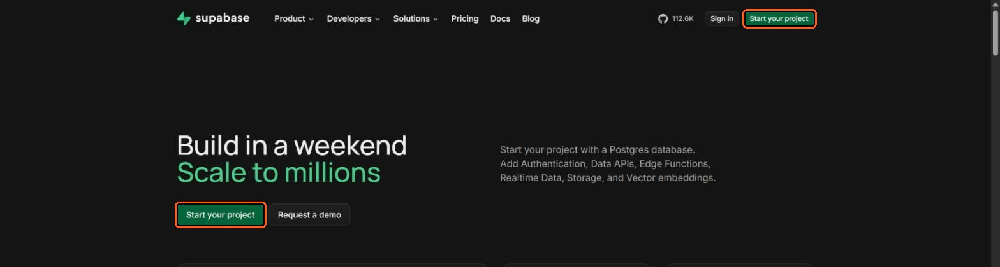

Escolha como entrar: **Continue with GitHub** é o caminho mais curto; com **e-mail e senha** o Supabase manda um link de confirmação antes de liberar o painel.

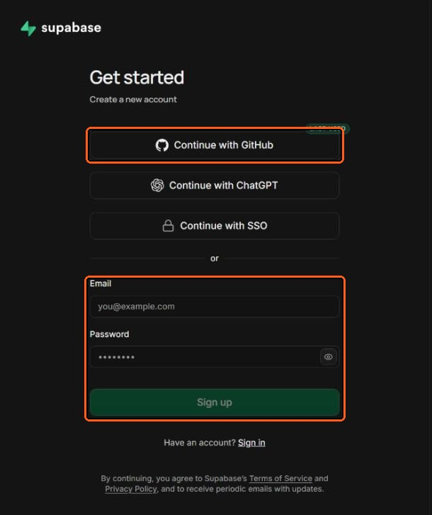

## 2. Criar uma organização

No Supabase, projetos ficam dentro de uma **organização** (é nela que fica o plano e a cobrança). Se você acabou de criar a conta, o painel já pede uma. Se já tem conta, a lista de organizações aparece; use uma existente ou clique em **New organization**.

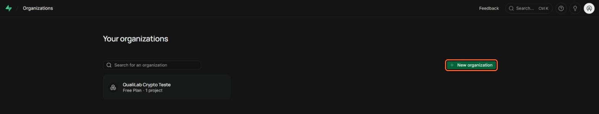

Dê um nome (o do grupo de pesquisa, por exemplo), deixe **Type** como está e confira que **Plan** é **Free - $0/month**. Clique em **Create organization**.

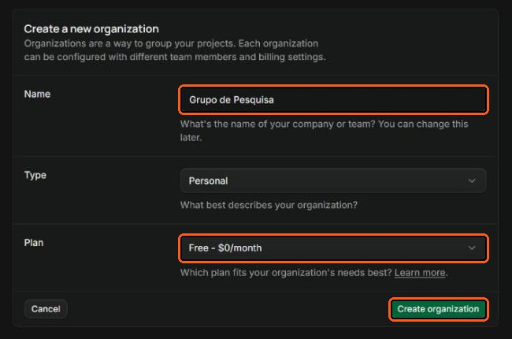

> **Por que o plano Free?** Ele basta para começar (500 MB de banco). Uma organização paga cobra cada projeto novo por hora de uso; se a sua já for paga, crie o projeto do QualiLab numa organização Free à parte, a menos que você queira mesmo pagar por ele.

## 3. Criar o projeto

Dentro da organização, clique em **New project**.

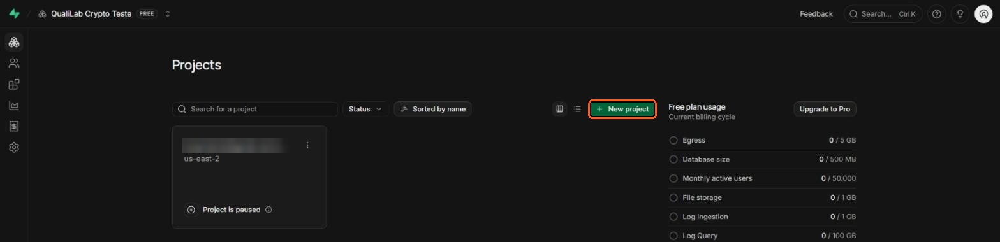

Preencha o formulário:

- **Project name**: qualquer nome (aqui, `qualilab-guia`).
- **Database password**: clique em **Generate a password** e depois em **Copy**, e guarde a senha num gerenciador de senhas. O QualiLab **não usa** essa senha (ele conversa com o banco pela API), mas ela é a chave-mestra do Postgres; se perder, dá para redefinir depois pelo painel.
- **Region**: abra **Need a specific region?** e escolha **South America (São Paulo)** `sa-east-1`. Fica mais perto de quem usa no Brasil, então o app responde mais rápido, e os dados ficam hospedados no país, o que pode pesar numa avaliação de comitê de ética.

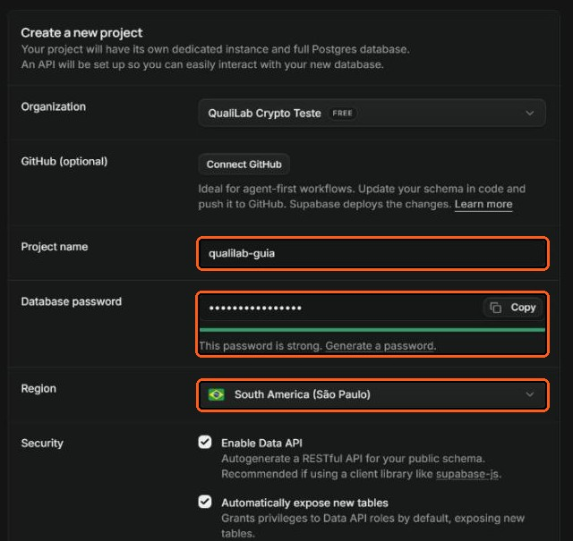

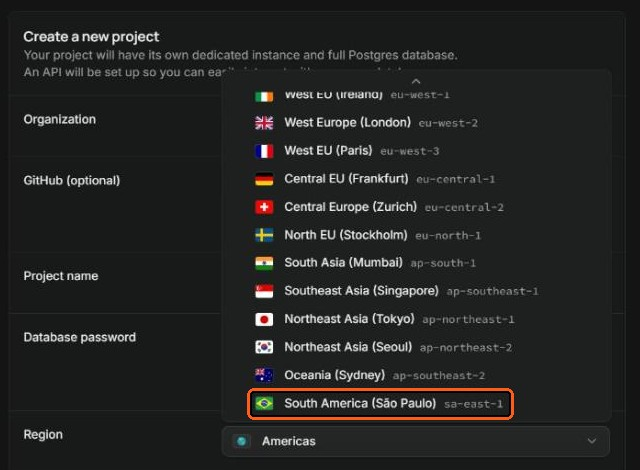

Em **Security**, deixe as opções como vêm: **Enable Data API** ligado (o QualiLab precisa dele), **Automatically expose new tables** ligado e **Enable automatic RLS** desligado. Foi com essa combinação que este guia foi testado. O `schema.sql` liga a proteção por linha (RLS) em todas as tabelas dele e concede as permissões por conta própria, então o banco não fica aberto por causa dessas opções. Clique em **Create new project**.

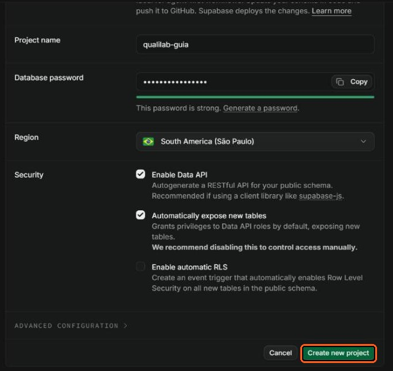

Em menos de um minuto o painel do projeto abre com **STATUS Healthy**. A linha logo abaixo do nome é a **URL do projeto** (`https://<código>.supabase.co`): você vai precisar dela no [passo 7](#7-conectar-o-qualilab-ao-seu-supabase).

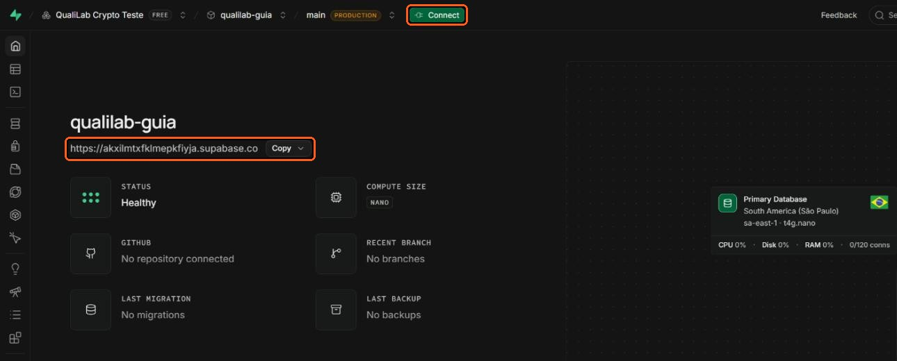

## 4. Instalar o banco do QualiLab (`schema.sql`)

O projeto nasce vazio. O `schema.sql` cria as tabelas, as funções, as regras de acesso (RLS), os depósitos de arquivos e o tempo real que o QualiLab usa.

1. No menu da esquerda, abra o **SQL Editor** (o ícone `>_`).
2. Cole **todo** o conteúdo do [`schema.sql`](../supabase/schema.sql) no editor (são cerca de 1.900 linhas; no GitHub, **Raw** ▸ `Ctrl+A` ▸ `Ctrl+C`).
3. Clique em **Run**.

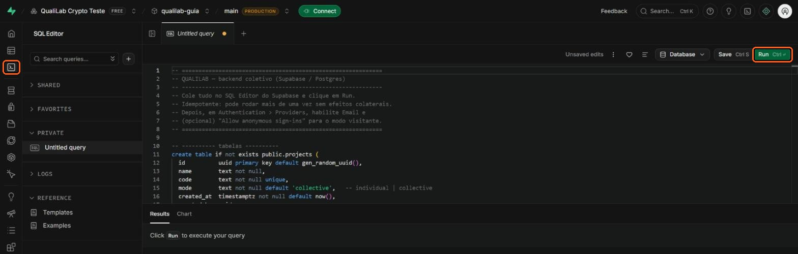

O Supabase avisa **Potential issues detected**: o script tem `drop policy`, `drop function` e um `update` sem `where`. É esperado. Esses comandos existem para o script poder rodar de novo sem duplicar nada, e num projeto novo não há dado nenhum para apagar. Clique em **Run query**.

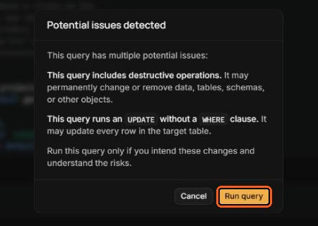

Em alguns segundos aparece **Success. No rows returned**. O banco está pronto.

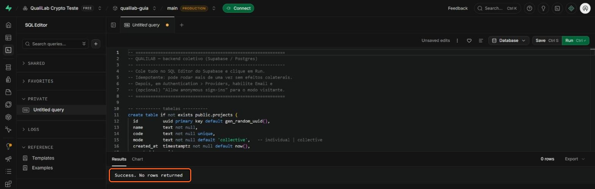

**Conferir (opcional).** Numa aba nova do SQL Editor (o **+** ao lado da aba atual), rode:

```sql
select count(*)                          as tabelas,
       count(*) filter (where rowsecurity) as com_rls,
       (select count(*) from pg_publication_tables
         where pubname = 'supabase_realtime' and schemaname = 'public') as no_realtime
  from pg_tables
 where schemaname = 'public';
```

Na versão atual do schema o resultado é **19 tabelas, 19 com RLS e 2 no tempo real** (codificações e respostas de categoria, as duas coisas que sincronizam ao vivo). Versões futuras podem ter mais tabelas; o que importa é `tabelas` igual a `com_rls`.

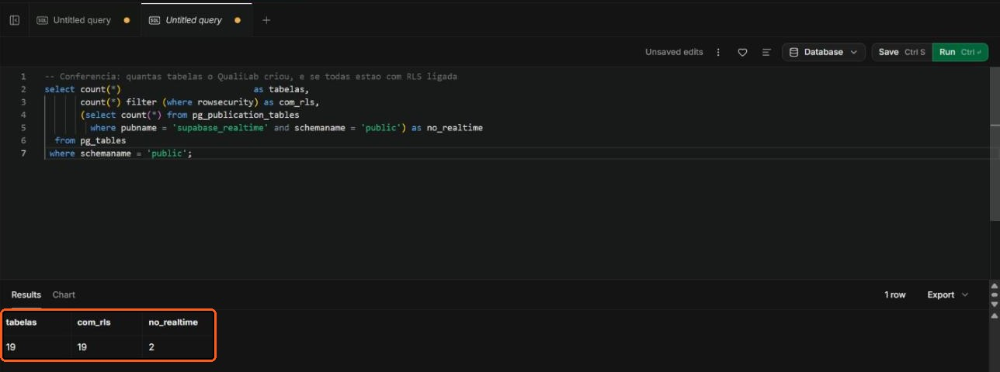

> **Atualizou o QualiLab?** Quando uma versão nova trouxer mudança no banco, basta rodar o `schema.sql` de novo, do mesmo jeito. Ele é idempotente: acrescenta o que faltar sem mexer nos dados.

## 5. Configurar o login

Tudo aqui fica em **Authentication** (o ícone de cadeado no menu da esquerda).

### 5.1. Sign In / Providers: conferir os padrões

Os padrões de um projeto novo já servem ao QualiLab. Confira:

- **Allow new users to sign up**: ligado (é assim que a equipe cria conta).
- **Allow anonymous sign-ins**: **desligado**. O QualiLab não tem modo visitante; os três jeitos de usar são arquivo, nuvem com login e rascunho.
- **Confirm email**: ligado por padrão. Veja a decisão logo abaixo, em 5.2.

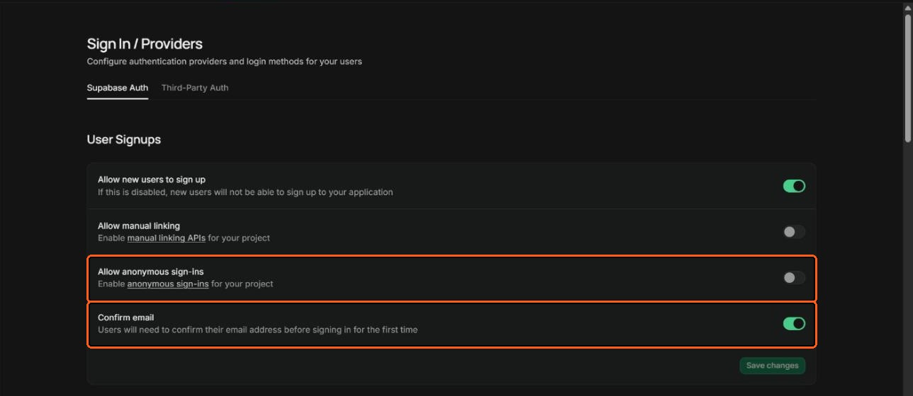

Mais abaixo, em **Auth Providers**, **Email** aparece como **ENABLED**.

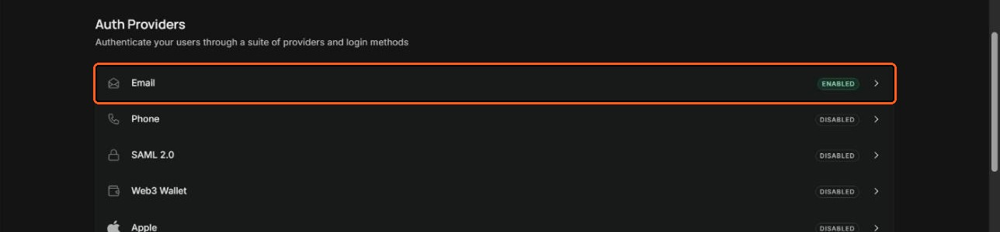

### 5.2. A decisão do e-mail de confirmação

Ao criar conta, o QualiLab pede um **código numérico** que chega por e-mail (não um link: filtros de caixas institucionais abrem os links sozinhos e os queimam antes da pessoa clicar). O problema é que o e-mail padrão do Supabase manda **um link**, e o Supabase só deixa trocar o texto do e-mail depois que você configura um **SMTP próprio**. Escolha um caminho:

| | Caminho A: rápido | Caminho B: uso real |
|---|---|---|
| **O que fazer** | Desligar **Confirm email** e clicar em **Save changes** | Configurar SMTP (5.4) e o template com o código (5.5) |
| **Cadastro** | Entra direto, sem código | Pede o código que chega por e-mail |
| **Serve para** | Testar, ou equipe pequena que se conhece | Equipe, turma, qualquer uso contínuo |
| **Limite** | O e-mail embutido continua mandando "Esqueci minha senha", a ~2 por hora | Começa em 30 e-mails por hora, ajustável |

No Caminho A, ninguém comprova ser dono do e-mail que digitou. Para a equipe, isso costuma ser aceitável porque ninguém entra num projeto sem o código de convite. Faça mesmo assim o 5.3: sem ele, o "Esqueci minha senha" não volta para o app.

### 5.3. URL Configuration

Em **Authentication ▸ URL Configuration**:

- **Site URL**: troque o `http://localhost:3000` que vem por padrão pelo endereço onde a equipe abre o QualiLab, por exemplo `https://luizpf42.github.io/QualiLab/`. Clique em **Save changes**.

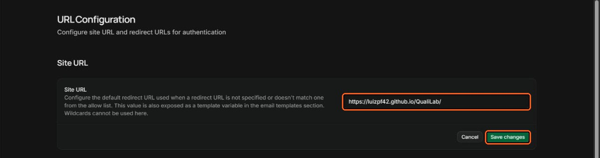

- **Redirect URLs**: clique em **Add URL**, cole o mesmo endereço terminado em `**` (`https://luizpf42.github.io/QualiLab/**`) e clique em **Save URLs**.

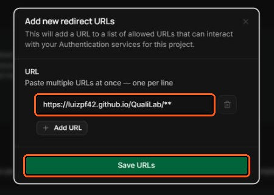

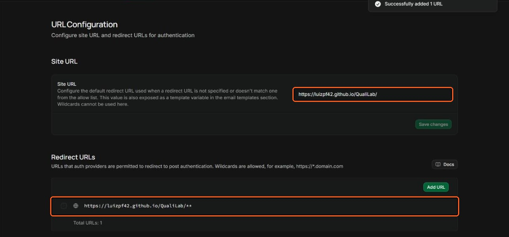

É para cá que voltam o link de **Esqueci minha senha** e o login com Google. Sem esta entrada, o Supabase manda a pessoa para o `localhost:3000`, que não abre nada. Se a equipe usa o QualiLab em outro endereço (uma cópia própria, o arquivo baixado servido em `localhost`), acrescente esse endereço também.

### 5.4. SMTP próprio (Caminho B)

Em **Authentication ▸ Emails**, a aba **Templates** avisa **Set up custom SMTP to edit templates**: é a trava descrita em 5.2.

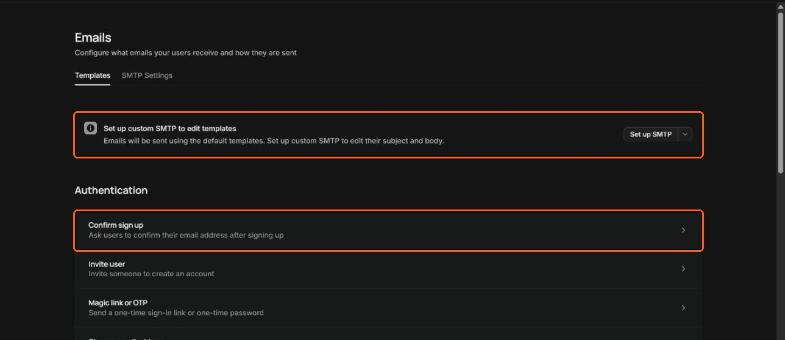

Na aba **SMTP Settings**, ligue **Enable custom SMTP** e preencha com os dados do seu serviço de e-mail: remetente (**Sender email address** e **Sender name**), **Host**, **Port number**, **Username** e **Password**. Clique em **Save changes**.

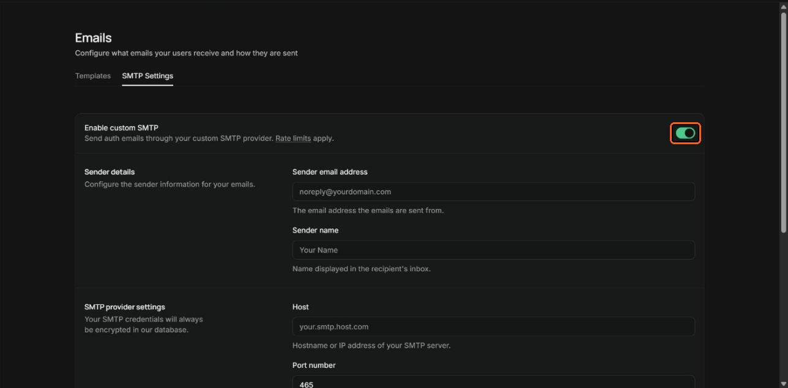

Qualquer serviço com SMTP serve (Brevo, Resend, AWS SES, Postmark, SendGrid, ZeptoMail). O **Brevo** dispensa domínio próprio: ele verifica um remetente individual, o seu e-mail institucional por exemplo. Com SMTP próprio o limite começa em 30 e-mails por hora; para turmas grandes, aumente em **Authentication ▸ Rate Limits**.

### 5.5. O template "Confirm sign up" (Caminho B)

Com o SMTP salvo, volte à aba **Templates**, abra **Confirm sign up** e troque o corpo por um que mande o **código** (`{{ .Token }}`) em vez do link (`{{ .ConfirmationURL }}`). Um modelo:

**Subject:** `Seu código de confirmação do QualiLab`

```html
<h2>Confirme seu cadastro no QualiLab</h2>
<p>Digite este código na tela "Confirme seu cadastro":</p>
<p style="font-size:28px;font-weight:bold;letter-spacing:6px">{{ .Token }}</p>
<p>O código vale por uma hora. Se você não pediu este cadastro, ignore este e-mail.</p>
```

Salve. O template **Reset password** pode ficar como está: a redefinição de senha continua sendo por link, e é por isso que o 5.3 é necessário.

**Tamanho do código.** Fica em **Sign In / Providers ▸ Email ▸ Email OTP length** (o padrão é 8 dígitos; aceita de 6 a 10). O QualiLab aceita qualquer um deles. Ali também está **Email OTP expiration**, a validade do código (3600 segundos, uma hora).

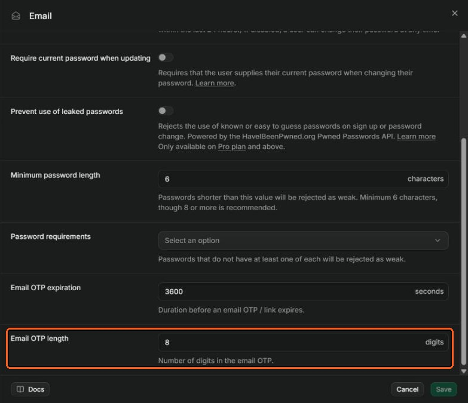

## 6. Copiar a URL e a chave

O QualiLab precisa de duas coisas do projeto:

1. **A URL**: a do painel do projeto (passo 3), no formato `https://<código>.supabase.co`.
2. **A chave `anon`**: em **Project Settings** (a engrenagem no fim do menu) **▸ API Keys**, abra a aba **Legacy anon, service_role API keys**.

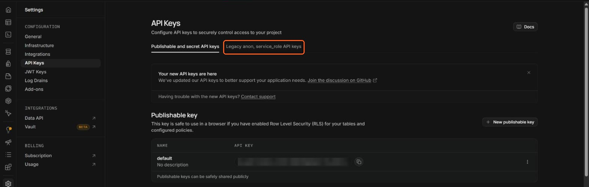

Copie a chave da linha **anon public** (começa com `eyJhbGci…`) pelo botão **Copy**.

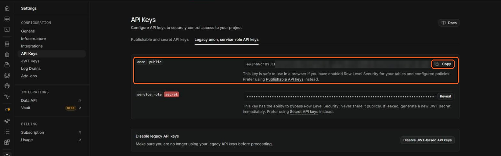

Três cuidados:

- **Use a `anon`**, que é a chave que o QualiLab espera. A **Publishable key** (`sb_publishable_…`, na primeira aba) é o formato novo do Supabase e não foi testada com o app.
- **Nunca use a `service_role`.** Ela ignora todas as regras de acesso; quem a tiver lê e apaga o banco inteiro. Ela não vai em lugar nenhum do QualiLab.
- **Não clique em "Disable JWT-based API keys"**: isso desliga a `anon` e derruba o app.

A `anon` é pública por desenho. Ela vai para o navegador de cada membro da equipe, e quem protege os dados são as regras de RLS que o `schema.sql` instalou. Pode mandá-la à equipe por e-mail ou mensagem sem drama.

## 7. Conectar o QualiLab ao seu Supabase

Abra o QualiLab ([luizpf42.github.io/QualiLab](https://luizpf42.github.io/QualiLab)). Na tela de entrada, clique em **Conectar ao meu Supabase**. O mesmo botão aparece na tela de login.

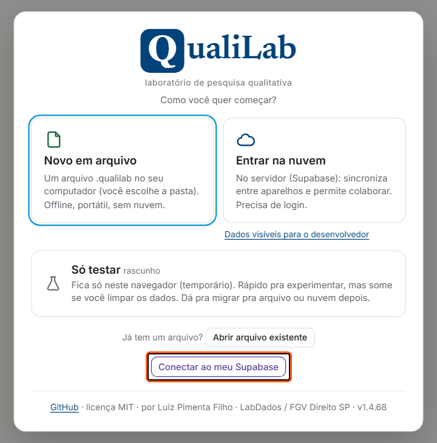

Cole a **URL** no primeiro campo e a **chave anon** no segundo, e clique em **Conectar e recarregar**.

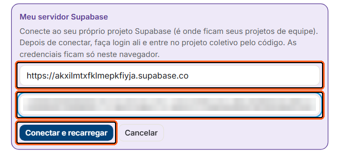

A página recarrega e passa a mostrar a pílula violeta **nuvem pessoal conectada**. Daqui em diante, **Entrar na nuvem** usa o seu banco. **Voltar ao servidor padrão** desfaz a conexão.

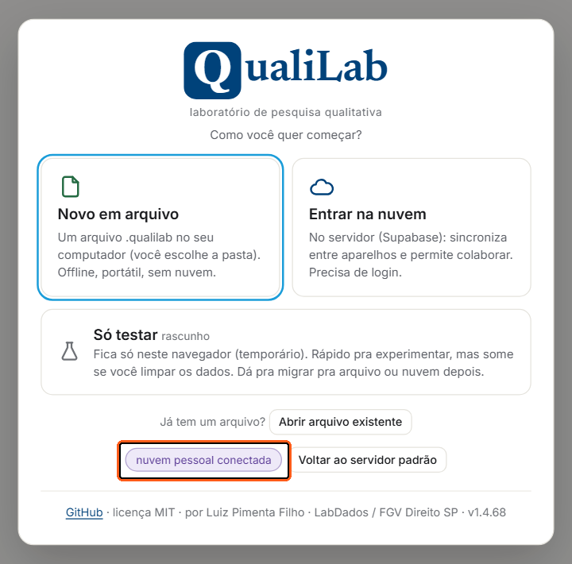

Em **Entrar na nuvem**, a primeira pessoa usa **Criar conta** (nome de exibição, e-mail e senha). No Caminho B, chega o código por e-mail; no A, a conta entra direto. Daí em diante é o fluxo de sempre: criar o projeto coletivo e convidar a equipe ([Manual, seção 13](MANUAL.md#13-colaboração)).

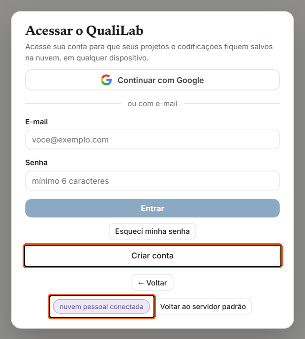

**E a equipe?** A conexão fica guardada **só no navegador** de quem a fez. Cada membro repete este passo uma vez, com a mesma URL e a mesma chave anon, e então cria a própria conta e entra no projeto pelo código de convite. Sem isso, a pessoa cai no servidor padrão e não encontra o projeto.

> Com um projeto já aberto, a mesma conexão fica na **pílula do projeto ▸ Conexão (Supabase)**. Quem publica a própria cópia do QualiLab pode fixar as credenciais no topo do `index.html` (`SUPABASE_URL` e `SUPABASE_ANON_KEY`), e aí ninguém precisa conectar à mão ([README](../README.md#configuração-da-nuvem-supabase)).

## 8. Opcionais: login com Google e IA pelo servidor

**Continuar com Google.** O botão aparece no login, mas só funciona se o projeto tiver o provedor Google configurado: **Authentication ▸ Sign In / Providers ▸ Google**, com um *OAuth client* criado no Google Cloud Console (o Supabase mostra o passo a passo e a *Callback URL* a cadastrar no Google). A Redirect URL do [5.3](#53-url-configuration) já cobre a volta para o app. Sem isso, use e-mail e senha.

**IA pelo servidor (Edge Function `ai-ask`).** Não é necessária. O padrão do QualiLab é cada pesquisador usar a **própria chave** de IA, e o navegador fala direto com o provedor. A função só serve para (a) oferecer uma chave do servidor à equipe ou (b) atender endpoints *Personalizado*/*Azure* que bloqueiam chamadas do navegador. O deploy é pelo painel, sem linha de comando: veja [README, seção 4](../README.md#4-ia-edge-function-ai-ask-opcional-só-para-chave-de-servidor-e-fallback-de-cors).

## 9. Manutenção e limites do plano gratuito

- **Pausa por inatividade.** Projetos do plano Free são **pausados** depois de um período sem uso (hoje, cerca de uma semana). Os dados não se perdem: abra o painel do Supabase e clique em **Restore project**. Quem passa semanas sem codificar deve contar com isso.
- **Tamanho.** O banco Free tem 500 MB, e os PDFs originais (quando a equipe consente em subi-los) contam no armazenamento de arquivos, de 1 GB. O uso aparece na página da organização (*Free plan usage*).
- **Cópias de segurança.** Confira em [supabase.com/pricing](https://supabase.com/pricing) o que o seu plano inclui de backup. Independentemente disso, exporte o projeto (`.qualilab`) de tempos em tempos e use o **Espelhar base** antes de operações grandes ([Manual, seção 16](MANUAL.md#16-salvamento-backup-e-modos-de-armazenamento)).
- **Atualizações do QualiLab.** Quando o [CHANGELOG](../CHANGELOG.md) disser que o banco mudou, rode o `schema.sql` de novo (passo 4).
- **Fechar o cadastro.** Quem tem a URL e a chave anon consegue criar conta no seu banco e ocupar espaço nele (não consegue ver os projetos da equipe, que exigem convite). Depois que toda a equipe tiver conta, dá para desligar **Allow new users to sign up** em *Sign In / Providers* e religar quando chegar alguém novo.
- **Duas pessoas administram melhor que uma.** Em *Organization ▸ Team* dá para convidar outra pessoa da equipe para o painel do Supabase. Se a conta do único administrador sumir, o banco fica sem dono.

## 10. Problemas comuns

**O e-mail de cadastro traz um link, mas o QualiLab pede um código.** O template ainda é o padrão do Supabase. Siga o Caminho A (desligar *Confirm email*) ou o B (SMTP + template com `{{ .Token }}`), em [5.2](#52-a-decisão-do-e-mail-de-confirmação).

**O e-mail não chega.** Sem SMTP próprio, o projeto inteiro tem cerca de 2 e-mails por hora, somando cadastros e "Esqueci minha senha". Olhe o spam e espere a hora virar, ou configure o SMTP (5.4).

**"Esqueci minha senha" abre `localhost:3000` ou uma página de erro.** Faltou a Site URL ou a Redirect URL do [5.3](#53-url-configuration).

**"Invalid API key" ou "No API key found".** A chave colada no QualiLab não é a `anon` deste projeto: confira se não veio a `service_role`, a publishable ou a chave de outro projeto, e se não sobrou espaço no começo ou no fim.

**Erros como `relation "public.projects" does not exist` ou `permission denied`.** O `schema.sql` não rodou inteiro. Rode de novo (passo 4) e confira com a consulta de conferência.

**O app não carrega nada e o painel do Supabase mostra o projeto pausado.** É a pausa do plano Free: **Restore project** no painel.

**Um membro da equipe não acha o projeto.** Ele não fez o [passo 7](#7-conectar-o-qualilab-ao-seu-supabase) no navegador dele (está no servidor padrão), ou entrou com outra conta.
